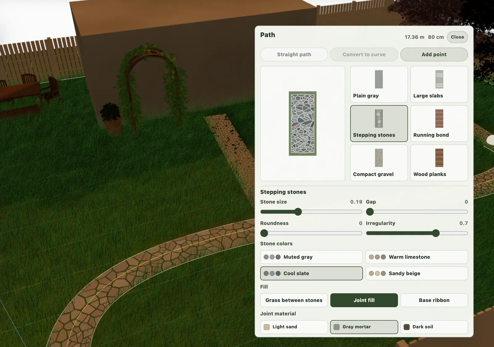
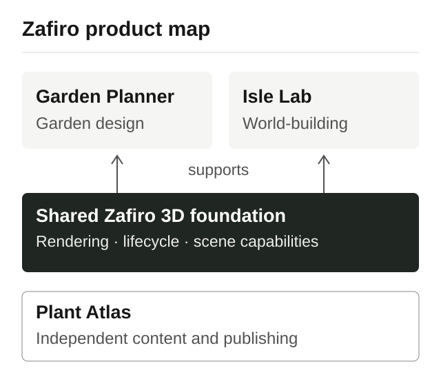

# Zafiro Showcase

A browser-based platform for spatial design, world-building and plant discovery.

[Zafiro](https://playzafiro.com/) · [Garden Planner](https://playzafiro.com/garden-planner/) · [Isle Lab](https://playzafiro.com/isle-lab/) · [Plant Atlas](https://playzafiro.com/garden-planner/plant-atlas/en/)

Zafiro provides a shared browser 3D foundation for **Garden Planner** and **Isle Lab**. Each product owns its tools and user journeys. **Plant Atlas** is an independent multilingual content product in the same ecosystem, with its own publishing lifecycle.

*Garden Planner: path and material controls in a composed garden. Archival interface image from the August 2026 portfolio materials; current controls may differ.*

## Three products

**Garden Planner** — compose a garden in 3D, work with paths and surfaces, save a local project and share a read-only published view. The product is in early development.

**Isle Lab** — shape terrain, adjust the environment and explore the composition of a small world.

**Plant Atlas** — search plant profiles covering mature size, growing conditions, care and garden use in English, Polish, German, French and Spanish.

*Simplified product map. The shared foundation supports rendering, runtime lifecycle and reusable scene capabilities. Plant Atlas operates independently of that 3D runtime.*

## Selected engineering notes

- [Shared foundation, separate products](docs/engineering-overview.md) — where reusable responsibilities end and product decisions begin.
- [From editing to a public garden](docs/case-studies/garden-project-lifecycle.md) — local persistence, deliberate publication and independent editable copies.
- [Multilingual plant publishing](docs/case-studies/multilingual-plant-atlas.md) — shared plant identity, language availability and publication readiness.

## Technical scope

| Area | Technologies and responsibilities |
| --- | --- |
| 3D applications | JavaScript, React, Three.js and WebGL; shared runtime and spatial interaction. |
| Plant Atlas | TypeScript, React and Next.js; structured content, localized search and static publishing. |
| Project state | Local persistence, validation and snapshot-based public views. |

## Repository scope

This repository presents selected product capabilities and engineering decisions. Application source code, original 3D assets, full datasets and operational documentation are outside its scope.

[Material usage](USAGE.md)
