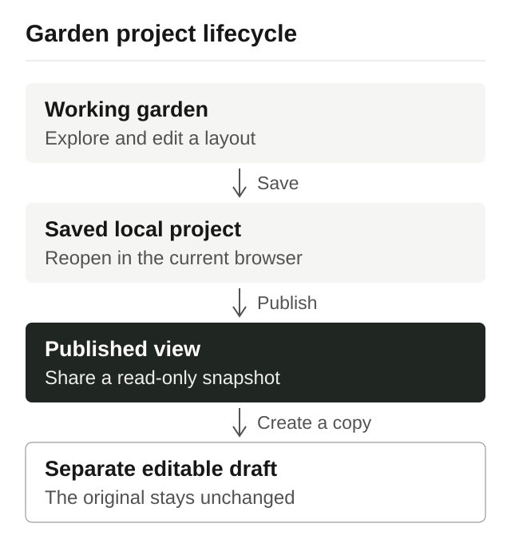

# From editing to a public garden

[Back to the showcase](../../README.md) · [Open Garden Planner](https://playzafiro.com/garden-planner/)

Garden Planner lets a design move beyond the current editing session. The central decision is to give working edits, a saved local project and a published view distinct roles.

## Context

A user can begin from a prepared garden or a blank plan, explore a layout and decide when it is worth keeping. They may later want to show the garden to someone else without handing over their editing workspace.

One “save” concept would leave several questions unresolved: whether experimentation already occupies a project, whether a visitor can change the original, and whether later edits immediately appear at the shared link.

## The user journey

1. **Edit a working garden.** Explore the layout before deciding to keep it as a named project.
2. **Save locally.** Keep a project in the current browser so it can be opened and developed further.
3. **Publish a view.** Share a snapshot of the saved garden through a separate public viewing experience.
4. **Create an editable copy.** A visitor can start a separate working draft from that view. Editing the copy does not change the originally published garden.

The diagram describes product behavior, not an implementation sequence.

## Decision: make saving explicit

A working session and a saved project answer different needs. The session supports ongoing work; a named project gives the user a deliberate place to return to. Opening a prepared design does not have to create a saved project immediately.

The save path validates the garden representation before storing it. Opening a saved project restores authored content into the interactive workspace. This keeps persistence concerned with the design rather than treating the current screen as the saved result.

**Trade-off:** local persistence makes the browser a useful workspace, but the project collection remains local to that browser and device. It does not provide automatic cross-device synchronization, and clearing browser storage can remove local work.

## Decision: separate publication from authoring

Publishing takes a saved design into a read-only viewing experience. That view is distinct from both the author's editing session and their local project collection. The public viewer does not open the author's local workspace.

The editable-copy action preserves that distinction. It starts a separate draft that can be changed and saved independently. For example, trying a different path layout in a copy does not change the garden that another person originally published.

**Trade-off:** a snapshot is useful for showing a particular design, but it is not real-time collaboration. Continuing to edit locally does not mean every change is being broadcast to visitors.

## Result and boundaries

The implemented lifecycle gives users three clear meanings: work on a garden, keep it locally, and publish a view. Validation, persistence and the public viewer each have a role in maintaining that distinction.

Garden Planner remains in early development. Local storage and snapshot sharing define the scope of this workflow: keep a design in the current browser, show a published version, and develop new ideas in independent copies.
